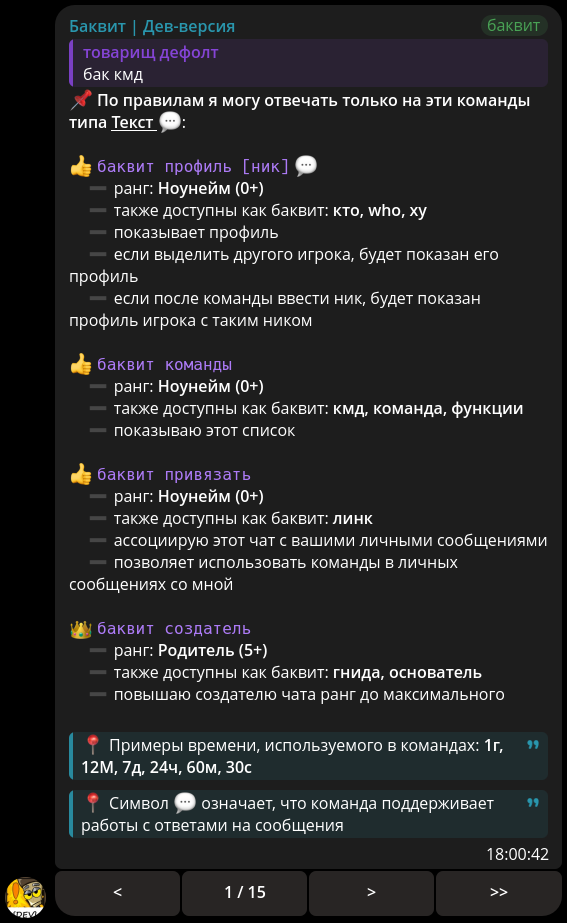

<p align="center">
    
    <br />
    <b>Добро пожаловать в Чаты Энвелла, я ваш проводник - Баквит!</b>
</p>


> `Баквит` - бот-администратор, созданный специально для чата https://t.me/envell_chat, но доступный всем остальным!

## Что умеет?

- **Умеет отвечать более, чем на 60 команд:**
    - 
- **Позволяет удобно управлять чатом (бан, мут, кик, ранги и тд)**
    - 
- **Имеет экономику**
    - 
- **Обладает развлекательными играми**
  - 
- **Профили, топы, заметки, правила, пользовательские рп-команды, сокращения команд, инвентарь, предметы, дуэли и т.д.**
  - 

## Как добавить *Баквита* в чат?

1. Перейти в профиль [Баквита](https://t.me/buckwheat_envell_bot)
2. Пригласить его в свой чат
3. Дать ему права администратора
4. ...
5. **ПРОФИТ!**

## Как захостить своего *Баквита*?

1. Установить последнюю версию *Bun*.
2. Установить последнюю версию *MongoDB*.
3. Скачать данный репозиторий, используя `git clone https://github.com/Rul991/buckwheat-bot` или через архив.
4. Переименовать `rename to .env` в `.env`
5. Получить токен через [@BotFather](https://t.me/BotFather)
6. Заполнить `.env`
   
    **Пример:**

    ```ini
    # полученный токен от @BotFather
    BOT_TOKEN = 1234567890:ABCDEFGHJKLMNOPQRSTUVWXYZabcdefghjk
    # можно оставить как тут, если mongodb установлен на тот же компьютер
    DB_URL = mongodb://localhost:27017
    # id чата
    CHAT_ID = -100000000000
    # твой id(не username) в тг
    DEV_ID = 1234567890 
    # prod или dev
    DEV_MODE = prod
    ```

7. Ввести в консоль `bun dev` или `bun start`
8. ...
9. **ПРОФИТ!**

[](https://creativecommons.org/licenses/by-nc/4.0/)